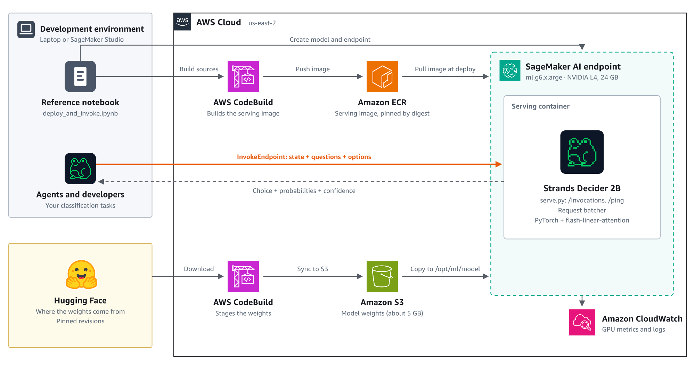

# Deploy Strands Decider 2B on Amazon SageMaker AI

This repository deploys [Strands Decider 2B](https://strandsagents.com/blog/introducing-strands-decider/), an open source decision model from Strands Labs, to an Amazon SageMaker AI real-time inference endpoint in your own AWS account. It includes a custom serving container with request batching, an AWS CodeBuild job that builds the image, and a second CodeBuild job that stages pinned model weights from Hugging Face in Amazon S3.



## What's in this repository

| Path | Purpose |
|---|---|
| `deploy_and_invoke.ipynb` | End-to-end walkthrough: IAM roles, both CodeBuild jobs, the endpoint, sample requests and cleanup |
| `container/Dockerfile` | Serving image: CUDA PyTorch, `strands-decider`, and the flash-linear-attention kernels |
| `container/serve.py` | SageMaker contract (`/ping`, `/invocations` on port 8080), model loading and warm-up |
| `container/batching.py` | Groups single-question requests from different callers into one GPU pass |
| `container/buildspec.yml` | CodeBuild steps that build the image and push it to Amazon ECR |
| `weights/buildspec.yml` | CodeBuild steps that download pinned weights from Hugging Face and sync them to S3 |
| `docs/architecture.png` | Architecture diagram |

The notebook writes the files under `container/` and `weights/` into a local `build/` folder with `%%writefile` cells, so it runs without the rest of the repository. The copies here make the code easy to read and review. If you edit one, edit the matching notebook cell too.

## Prerequisites

- An AWS account and credentials for it. The notebook uses **us-east-2**; change `REGION` in section 0 to use another Region.
- A service quota of at least 1 for **ml.g6.xlarge for endpoint usage**.
- Python 3.12 or later with `boto3`, in Jupyter or SageMaker Studio.
- Permission for the identity running the notebook to create IAM roles, CodeBuild projects, an ECR repository, S3 objects and SageMaker resources. The notebook's **Prerequisites** cell lists the exact actions and includes a minimal policy for SageMaker Studio execution roles.
- Internet access from CodeBuild to PyPI and Hugging Face.

You don't need Docker or a GPU locally. The image build and the weights download both run in CodeBuild.

## Quick start

1. Open `deploy_and_invoke.ipynb` in Jupyter or SageMaker Studio.
2. Review the configuration in section 0 (`REGION`, `PREFIX`, `ENDPOINT`, `INSTANCE`).
3. Run the cells in order. Creating the endpoint takes about 8 to 12 minutes, because the container compiles its Triton kernels during warm-up.
4. Run section 6, **Clean up**, when you're done.

The notebook creates these resources, all named with the `strands-decider` prefix:

- Two IAM roles: one for CodeBuild and one for the SageMaker endpoint, each scoped to this project's S3 prefix and ECR repository.
- An ECR repository and two CodeBuild projects.
- Objects under `s3://sagemaker-<region>-<account>/strands-decider/`.
- A SageMaker model, endpoint configuration and endpoint.

## Calling the endpoint

Requests use the Strands Decider "System One" format: a `state` and one or more named `questions`.

```python
import json
import boto3

smr = boto3.client("sagemaker-runtime", region_name="us-east-2")
body = {
    "state": {"request": "Translate 'good morning' into Spanish."},
    "questions": {
        "tier": {
            "type": "choice",
            "instructions": "How capable a model does `request` need?",
            "criteria": {
                "basic": "A quick, routine reply.",
                "standard": "Ordinary professional work needing some care.",
                "advanced": "Expert-level or high-stakes work.",
            },
        }
    },
}
response = smr.invoke_endpoint(
    EndpointName="strands-decider-v19",
    ContentType="application/json",
    Body=json.dumps(body),
)
print(json.loads(response["Body"].read()))
```

Example response:

```json
{
  "model": "strands-decider-2B-hobson-v19",
  "answers": {
    "tier": {
      "type": "choice",
      "choice": "basic",
      "probabilities": {"basic": 0.7548, "standard": 0.1883, "advanced": 0.0568},
      "confidence": 0.6322
    }
  },
  "usage": {"input_tokens": 101, "output_tokens": 1},
  "batch_size": 1,
  "latency_ms": 73.72
}
```

Question types are `choice` (pick one option), `noul` (yes or no) and `score` (a graded scale). Any application whose IAM identity has `sagemaker:InvokeEndpoint` permission on the endpoint can call it.

To bypass the batcher for a single request, for example to compare results, set the custom attribute `unbatched`:

```python
smr.invoke_endpoint(..., CustomAttributes="unbatched")
```

## Configuration

The SageMaker model's environment variables tune the batcher. They only affect single-question requests; requests with several questions run on the engine's shared-prefix path.

| Variable | Default | Meaning |
|---|---|---|
| `MAX_BATCH` | 32 | Maximum rows in one forward pass |
| `MAX_BATCH_TOKENS` | 16384 | Maximum rows x padded length in one forward pass |
| `MAX_DELAY_MS` | 5 | How long a short batch waits for more requests |

## Performance

Measured on one ml.g6.xlarge in us-east-2 with single-question requests of about 100 input tokens. The client ran outside AWS, so end-to-end latency includes about 50 ms of network round trip.

| | Default engine | With the batcher |
|---|---|---|
| Model latency, one request | about 70 ms | about 70 ms |
| Peak throughput | about 14 requests/s | about 50 requests/s |
| Median end-to-end latency at 8 concurrent requests | 574 ms | 149 ms |

The weights take about 5 GB in bf16, and the endpoint used about 5 GB of the L4's 24 GB of GPU memory under load. Results depend on input length and traffic, so load-test your own workload before choosing a production instance size.

## Cost

The ml.g6.xlarge endpoint costs about $1.13 per hour on demand in us-east-2 until you delete it, plus a few cents for CodeBuild and S3 storage. Check [SageMaker AI pricing](https://aws.amazon.com/sagemaker/ai/pricing/) for your Region. Section 6 of the notebook deletes everything the notebook created.

## Pinned versions

| Component | Version |
|---|---|
| Model checkpoint | `StrandsAgents/strands-decider-2B-hobson-v19` @ `bb282d786bc251fd4e3068de3ada9ddbb38127cd` |
| Base model | `Qwen/Qwen3.5-2B-Base` @ `b1485b2fa6dfa1287294f269f5fb618e03d52d7c` |
| `strands-decider` | 0.1.0 |
| PyTorch | 2.7.1 (CUDA 12.6) |
| `transformers` | 5.17.0 |
| `flash-linear-attention` / `fla-core` | 0.5.2 |

`batching.py` calls internal helpers of the `strands-decider` engine, so upgrade that package only after re-testing the batcher.

## Troubleshooting

- **The endpoint fails before it's InService.** Read the container log at `/aws/sagemaker/Endpoints/<endpoint-name>` in CloudWatch Logs. Most failures are a missing kernel dependency or the startup health check timing out during warm-up. `ContainerStartupHealthCheckTimeoutInSeconds` is set to 900 for this reason.
- **`AccessDenied ... iam:CreateRole` in SageMaker Studio.** The Studio execution role can't create IAM roles by default. Add the minimal IAM policy from the notebook's Prerequisites cell from an account with admin rights.
- **`ResourceLimitExceeded` when creating the endpoint.** Request a quota increase for ml.g6.xlarge for endpoint usage in Service Quotas.

## Licences

The code in this repository is licensed under MIT-0; see [LICENSE](LICENSE). The model weights are downloaded at build time and aren't redistributed here. [Strands Decider](https://github.com/strands-labs/strands-decider) and [Qwen3.5-2B-Base](https://huggingface.co/Qwen/Qwen3.5-2B-Base) are both licensed under Apache 2.0, and you accept their licences when you download them.
